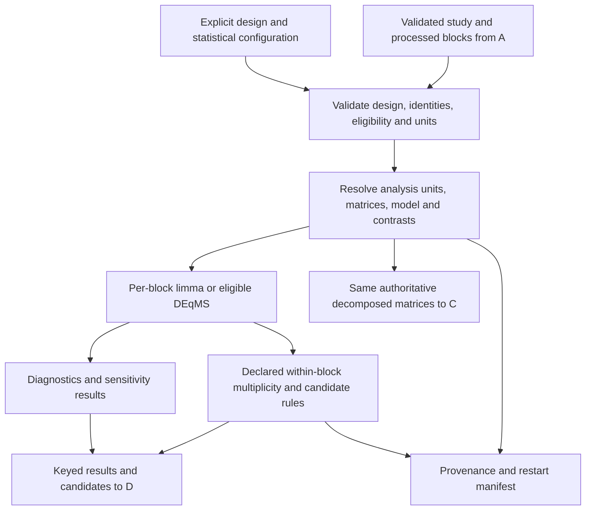

# B — Design resolver and per-block statistics: provisional design package

## Adopted design settlement — 2026-09-06

The user delegated unresolved choices to Opus/Sol and Astra. The [settlement](../operations/contract-settlement.md), [Astra arbitration](../reviews/astra-design-arbitration.md), [command contract](../operations/implementation-command-contract.md) and [individual tickets](../tickets/README.md) now supersede conflicting pending alternatives in the older draft below. Design is settled within these bounds; runtime, scientific validation and original G0 are still open; R core plus Python is explicitly approved. Two-occasion change uses signed deltas shared with C; level/mean questions use separate Analyses. Longer within-person/trajectory branches require explicit model/rank/calibration gates. Per-scalar-contrast/claim per-Block BH is the default, with fixed declared membership/internal p=1 for failed fits and no union-FDR claim. B owns all clinical fits; B-T08/09 precede B-T07 handoff. B-T07 writes Markdown reproduction, not early QMD.

**Status: independently reviewed provisional draft; NOT implementation-ready.** Dated 2026-09-05. See the [draft review](../reviews/B-spec-review.md), [revision response](../reviews/B-spec-review-response.md) and [shared contract proposal](../operations/shared-contract-proposal.md). This package proposes detail without accepting changes to the supplied contracts. R confirmation, historical reconciliation, representation/model decisions, pinned dependency verification and final readiness review remain open. No production code, new dependency, implementation test, issue publication or statistical validation is claimed.

Inputs read: preserved execution prompt and architecture context under `discovery/inputs/`, `discovery/README.md`, root `CONTEXT.md`, and `discovery/research/BC-methods.md`. The requested `discovery/CONTEXT.md` does not exist; root `CONTEXT.md` supplies the glossary. Historical component B maps to architecture-context §§6–7 and implementation milestone 4; no older numbering is invented.

The actual `to-spec` and `to-tickets` SKILL.md files were read. Their synthesis, user stories, highest-level testing seam and vertical-slice approach are used. Explicit draft-only instructions supersede publishing, ready-for-agent labeling and per-ticket published files. Proposed seams and ticket granularity remain review questions; this document does not claim approval. Concrete owned files and schemas are included because the user's specification-kit requirements explicitly require them.

## 0. Three-study revision — 2026-09-06, proposed for confirmation

Read with the [source contract](../operations/source-contract-proposal.md), [Opus review](../reviews/opus-three-study-design-review.md) and [root response](../reviews/opus-review-response.md). No new model or protected shared-matrix amendment is accepted here.

B consumes Study-scoped eligible measurement sources, selection evidence and the A source/Feature registries. Result envelopes require `study_id`, source references and `origin=recomputed_in_run`. All joins use the approved internal Feature key with visible original ID/namespace; a bare molecular ID tuple cannot represent repeated source rows. Imported p/q/FC never enters a fit or adjustment family. Adding imported sidecars cannot change eligible measurement values, family membership or q.

### Group-by-visit estimands and representation

Extend repeated-design metadata with `between_factors`, `within_factors`, explicit subject/visit/group columns and named estimands; retain the independent/repeated/trajectory `design.kind` distinction. Each estimand declares type, target levels/visit weights, direction, analysis population, missing-visit policy, covariates and approved `representation_id`. The resolver records retained signal, projection definition, model/contrast rank and estimability before fitting.

| Target | Required representation/eligibility |
|---|---|
| Independent three-group contrasts | Existing independent resolver with explicit contrasts/family; group labels alone do not establish independence. |
| Within-group visit change | Visit contrast retaining within-subject signal; verified metadata and covariance/df handling. |
| Difference in change between groups | Group contrast of subject visit contrasts under approved assumptions; deltas are illustrative, not an accepted score-row amendment. |
| Between-group level at a visit or subject-mean difference | Representation retaining between-subject signal; subject-centering removes it. Alternative needs DEC-05 / ADR-B-01/02 / X-R04 approval. |

For orthogonal centering projection P, a raw contrast L can be recovered from P*y only if L = L*P. This necessary signal-retention check does not establish covariance validity, covariate estimability, design rank or finite-sample inference; each is checked separately. Time-invariant group main effects cannot be separately fitted with saturated subject fixed effects. `B_NONESTIMABLE` names the target and projection/model reason, never returns a structural zero as no difference. All requested targets remain visible; none is silently dropped.

B/C consume the same approved representation within each Analysis and fold. C cannot receive raw data under a within-change representation ID. A separate between-group Analysis retaining means is an explicit protected decision. Difference-in-change being mathematically possible does not close the n-versus-nk score/unit contract or approve a repeated model.

Proposed incomplete-visit policy retains `error` default and adds `complete_pairs_per_contrast` for approved two-visit contrasts. Report starting/eligible/retained/excluded subjects and observations per group, available missingness reasons, `n_complete_pairs`, `n_used`, `n_subjects_used`, `n_analysis_rows` under existing definitions, and the changed target population. Equal attrition counts do not prove unbiasedness; unequal counts do not automatically invalidate a fit. Completeness and limitations follow explicit policy/method eligibility, with no invented imbalance threshold or forced partial status. Missing visits are not imputed in this mode; other longitudinal approaches remain separately reviewed choices. Directional consistency is computed within the relevant group/contrast or marked not-applicable with reason.

### Selection, failures and existing tickets

Before q calculation, validate the shared contract's `selection_validity` and declared eligible hypothesis family, including membership digest/count and rationale. A justified panel/valid filter is not prohibited merely for being a subset. Unknown or outcome-selected upstream inventory has no ordinary BH claim without an approved valid analysis. `B_SELECTION_UNVERIFIED` / `B_SELECTION_INELIGIBLE` withholds q and significance nominations with reason. Effect/SE/p validity is separate; conditional/descriptive displays retain selection limitations. Withholding q is not bias correction. All adjustment families stay per Block, never pooled across Blocks/Studies.

Whole-assay absence excludes that unit only from the applicable Block fit under the declared coverage policy, not by silent global intersection or feature imputation. Expose per-Block coverage/denominators. `B_INELIGIBLE_SOURCE_ROLE` and `B_CROSS_STUDY_INPUT` fail before fitting.

ADR-B-01/02 owns group-by-visit representation/units; ADR-B-04 owns selection-valid families; ADR-B-05 owns incomplete visits/attrition. B-T01 gains source/Study/estimand eligibility; B-T03 gains group-by-visit estimability/refusal and per-group attrition; B-T06 gains q eligibility and imported-statistic isolation; B-T07 exports these fields to C/D. Add TS-04/05/07/08/09: hand-check arbitrary synthetic group means of complete-subject deltas, direction reversal, one missing visit, permutations and a projected-out effect request. Existing statistical calibration/sensitivity/API checks remain required. None of these tests or a new statistical method has been executed.

## 0.1 Clinical–molecular association extension — proposed

The [shared clinical extension](clinical-molecular-association-extension.md) adds an ObjectiveRegistry and one B-owned public association service for immutable molecular/score endpoints and clinical metadata. B owns model direction, between/within/baseline-to-later estimands, adjustments, missingness, selection, uncertainty and explicit clinical-endpoint families while retaining per-Block FDR. B-T08/09 implement bounded independent/repeated association slices at milestone 4 using synthetic score artifacts; C later requests score associations through the same service. No universal correlation fallback, new model, protected representation change or clinical inference has been approved/executed.

## 1. Problem statement, scope and contribution

A study can have paired observations, independent groups, a continuous predictor, several visits or trajectories. Applying a convenient model without respecting analysis units, covariance, covariates and contrast direction can produce apparently precise but invalid molecular findings. B must make its estimand and limitations reviewable before fitting and preserve the shared-decomposition principle across inference and integration.

**Solution:** resolve an explicit design into a documented analysis-unit mapping, common decomposed block matrices, a valid per-block model, explicit contrasts and method-specific inference. Return auditable results with each feature's effect, uncertainty, multiplicity family, observation counts, directional-consistency status and provenance. Any unsupported or unresolved design fails clearly before inference rather than being coerced into a simpler design.

**Owned:** design validation and resolution; statistical decomposition after A's block processing; model matrices/contrasts; limma and conditional DEqMS orchestration; configured rank sensitivity analysis; per-block multiplicity and candidate nomination; model/inference provenance. B may validate A's outputs and consume A-derived features. B does not repeat A filtering/imputation, derive lipid features itself, annotate molecules, implement C's backends or render D's report.

**Preserved contracts:** the supplied BlockProfile function signatures and IntegrationResult fields are unchanged. Both per-block statistics and integration consume the same authoritative decomposed matrices. B's proposed result records can reference those matrices but cannot silently substitute unrelated representations. FDR remains separate by block. Names are labels, not behavioral switches; tests must cover two and five blocks. Both result branches remain available to both molecule-type annotation routes. No real study data enter version control.

**Closest precedent:** limma already implements linear-model contrasts and empirical-Bayes variance moderation; DEqMS extends prior variance modeling using quantified peptide/PSM counts; mixOmics supplies within-subject multivariate decomposition. B's proposed contribution is orchestration, a generic analysis-unit/estimand contract, clear failure semantics, shared provenance and calibration checks. It is not a new statistical estimator or proof of superiority. The proposed naive combination of subject-centering and duplicateCorrelation is not established merely because each individual method has a precedent. Primary-source evidence and limits are indexed in the [B/C ledger](../research/BC-methods.md), B-01–B-05 and C-02.

**Proceed criteria:** all four complete design packages reviewed; technology confirmed; relevant B ADRs accepted; a pinned compatible environment; executable model/df/NA checks; substantive tests and scientific calibration; reproducible outputs. **Narrow/defer proposals:** hold an unsupported covariance/design/count scenario with an explicit eligibility error while completing its design and identifying reopening evidence. Deferral does not remove a resolver row, cancel B, label it implemented or authorize arbitrary-design claims. Any user-accepted narrowing must be an ADR.

### User stories

1. As an analyst, I want a clear contrast direction, so an increase cannot silently become a decrease.
2. As an analyst, I want independent studies to work without subject IDs, so the first paired dataset does not define the product.
3. As an analyst, I want repeated observations linked to their subjects, so precision reflects independent experimental units.
4. As an analyst, I want the resolved design printed before fitting, so I can inspect the estimand and omitted effects.
5. As an analyst, I want time-varying covariates transformed with the response where required, so adjustment is mathematically coherent.
6. As an analyst, I want time-invariant effect modification distinguished from main-effect adjustment, so delta-model coefficients are not misinterpreted.
7. As an analyst, I want missing pairs and missing covariates handled by a declared policy, so eligibility is reproducible.
8. As an analyst, I want peptide-count provenance checked, so DEqMS is not selected using unrelated metadata.
9. As an analyst, I want species, class and derived results distinguished, so their units and testing families remain clear.
10. As an analyst, I want separate block-level q values, so adding a larger block cannot change another block's BH adjustment.
11. As an analyst, I want sensitivity disagreements reported without voting them away, so uncertainty is visible.
12. As an analyst, I want directional consistency only where its numerator has a valid meaning, so independent samples are not described as having moved.
13. As a backend author, I want stable analysis-unit IDs and matrix provenance, so integration uses the same resolved signal.
14. As a reviewer, I want ordinary and moderated uncertainty explicitly labeled, so I can reproduce the reported test.
15. As a reviewer, I want failed estimation retained with reasons, so missing results cannot masquerade as nonsignificance.
16. As a maintainer, I want versioned restart artifacts, so interrupted fits are recoverable without mixing incompatible runs.

## 2. Dependency-by-question coverage and version/namespace manifest

| Question/risk | Dependency or mathematical evidence | Version / inspected artifact | What is established | Remaining verification |
|---|---|---|---|---|
| B-01 paired/delta versus fixed effects | limma `lmFit`, `eBayes`; algebra | Release page 3.68.5; source RELEASE_3_23 `R/lmfit.R`, `R/ebayes.R` | Distinct regression/GLS paths; equations in ledger | Executable coefficient, SE, df and moderation identities/counterexamples |
| B-02 centered repeated covariance | limma `duplicateCorrelation` and GLS; projection algebra | Current manual `dupcor`; `gls.series` source | Compound-symmetric fitting; centering rank loss | Valid alternative selection and null calibration |
| B-04 moderation/SE | limma `eBayes`, `squeezeVar` | 3.68.5 catalogue; source-inspected moderation | Posterior variance and augmented df | Exact installed options, trend/robust handling and calibration |
| B-05 count-adjusted inference | DEqMS `spectraCounteBayes` | 1.30.0 catalogue; current manual; 3.21 official vignette §2.1.5 | Fit plus aligned `$count`; method-specific outputs | Current source/metadata checks; delta/count prior adequacy |
| C-02 shared within matrices | mixOmics `withinVariation(X, design)` | 6.36.0 manual pp.268–269; RELEASE_3_23 metadata commit 0f4d16c | Returns within matrix; ID column semantics | Installed source, missing/singleton behavior; no automatic B dependency accepted |
| Storage/alignment | SummarizedExperiment, MultiAssayExperiment | User-proposed; versions not verified in this package | Architectural role only | Cross-component A manifest and executable accessors |
| Continuous/trajectory design | R model matrix and spline facilities | Version unresolved | Proposed use of established linear-model machinery | Exact basis/contrast API documentation and estimability checks |
| Rank sensitivity | R rank-test facilities or other approved existing dependency | Method/API unresolved | User requires sensitivity for eligible profiles | Choose estimand, pairing, ties/zero policy and covariate limitation before dependency/API commitment |

Source metadata and primary citations are in the ledger; that source inspection is not runtime verification. limma is GPL >=2, DEqMS currently advertises LGPL without an exact version, mixOmics is GPL >=2. MOFA2 belongs to C. The 6.36.0 mixOmics release requires R >=4.4, so the supplied R >=4.3 floor cannot alone support all current releases. R/Bioconductor selection and exact transitive dependency/licence audit remain open. No copying/vendoring of package source is proposed. Redistribution review must cover the actual chosen distribution, notices and license files.

**Identifier handling:** B accepts any A-validated namespace string; it does not map IDs. A measured-feature key is `(block_id, id_namespace, feature_id)`. A derived-feature key also records its unique feature ID, definition, source feature keys, quantity type and units. Same ID text across namespaces/blocks is not a collision; duplicate keys within one result family are. Built-in namespaces from the user are uniprot, gene_symbol, hmdb, kegg_compound and lipid_shorthand; B performs no KEGG access or redistribution. New namespaces need A/D registration, not B branching on a block name. Derived class features must not falsely claim an external identifier namespace without A's approved schema.

**Representative verification artifacts:** planned BC-V01–V04 in the ledger, plus model-design rank reports, explicit contrast matrices, paired analysis-unit maps, count-alignment reports and family membership manifests. None has been generated by an executable statistical check.

## 3. Proposed exposed contract, invariants and errors

Everything labeled “proposed” below is a triomics schema proposal, **not an existing package API**. No exported R function name is asserted. Keep one high-level B entry seam that receives the validated study/profile output and design configuration, and returns all resolved matrices/results/provenance. The orchestrator must approve this seam after historical reconciliation. Package calls remain internal and version-verified.

### Inputs

| Record | Required fields / semantics | Constraints |
|---|---|---|
| Block collection | Named collection of A-validated SummarizedExperiment blocks plus assembled study sample mapping | Feature × sample assays; two to N blocks; identities validated by keys, never position alone |
| Matrix provenance | Assay identifier, transform/normalization/imputation history, feature retention ledger, observed/imputed mask, quantity/unit metadata | Immutable input hash; method-required fields complete; B cannot rerun preprocessing silently |
| Sample metadata | `sample_id`; configured condition/outcome and covariates; subject ID only if repeated; actual times if trajectory | Explicit type and level order; no inferred pairing from row order |
| Feature metadata | feature key, profile/statistics capabilities, `feature_level` measured/class/derived, effect units; count metadata when supplied | DEqMS dispatch by declared count/statistics capability, never block display name |
| Design | Existing `design.subject_id`, `condition`, `condition_type`, `covariates`, `repeated` | Existing keys retained; proposed extensions below resolve ambiguity |

### Configuration proposal

| Key | Value domain / meaning | Default status |
|---|---|---|
| `design.kind` | `independent`, `repeated`, `trajectory`; explicit precedence with existing repeated/condition_type fields | Proposed; conflicting declarations error |
| `design.subject_id` | Metadata column or null | Existing; required only for repeated/trajectory with repeated specimens |
| `design.condition` | Metadata predictor column | Existing; always explicit |
| `design.condition_type` | `factor` or `continuous` | Existing; cannot coerce automatically |
| `design.level_order` | Complete ordered factor levels | Proposed; mandatory for categorical contrasts |
| `design.contrasts` | Named human-readable contrast declarations resolving to numeric coefficients; continuous slope per declared unit | Proposed; require explicit tested estimand; numeric matrix printed after resolution |
| `design.covariates` | Existing list of metadata columns | Existing; each needs explicit time-varying/time-invariant classification in repeated studies |
| `design.covariate_roles` | Per-column `time_varying`, `time_invariant`, or `effect_modifier`, with origin/units | Proposed; no age/BMI heuristic based on column name |
| `design.interactions` | Named effect-modification terms, target predictor and contrast | Proposed; require exploratory warning/correct parameterization |
| `design.incomplete_pairs` | `error` or explicitly approved `complete_pairs` policy | Proposed default `error` pending review; exclusion ledger mandatory if allowed |
| `design.missing_covariates` | `error` or declared complete-case eligibility | Proposed default `error` pending review; no silent imputation |
| `design.replicate_policy` | Error or A-approved aggregation provenance for >1 specimen per subject/level | Proposed; no implicit averaging |
| `design.repeated_model` | Explicit reviewed model strategy identifier | Unresolved; original mapping is challenged, not replaced |
| `design.trajectory.time` | Numeric metadata time column and unit | Proposed; explicit for trajectory |
| `design.trajectory.basis` | Approved basis name plus fixed df/knots/boundaries and tested trajectory contrast | Proposed; no sample-dependent silent complexity |
| `statistics.method` | Per profile/capability `limma` or eligible `deqms` with fallback policy | Original backbone retained; eligibility details pending |
| `statistics.moderation.trend` | False, true or approved explicit covariate semantics | Proposed explicit setting; no universal scientific default |
| `statistics.moderation.robust` | Boolean plus pinned option semantics | Proposed explicit setting; small n is not blanket justification |
| `statistics.counts` | Count source, kind, feature key, aggregation rule and missing-count policy | Required only when DEqMS requested/selected |
| `statistics.sensitivity` | Named approved rank sensitivity with estimand, pairing and ties policy; disabling is allowed only for a non-required profile or an explicitly accepted waiver | Required built-in profile behavior cannot be removed by ordinary configuration; capability/status rules below |
| `statistics.multiplicity.method` | BH as proposed method, other methods only if separately justified | BH is a design choice, not forced by backend |
| `statistics.multiplicity.within_block_family` | `all_tests` or explicit partition by contrast/feature level, with declared interpretation | **Unresolved; per-block separation mandatory in either choice** |
| `statistics.q_cutoff` | Numeric probability threshold | User must set/approve justified value; none invented here |
| `statistics.effect_floor` | Nonnegative threshold with explicit unit and feature-level scope | Configurable user requirement; cannot label CLR coefficients log2FC |
| `statistics.directional_consistency` | Declared metric definition, feature scale, observed/imputed contrast policy, zero/tie policy and eligible design | Paired sign count on approved decomposed-feature scale proposed; outside pairing NA with reason until defined |
| `execution.seed` | Explicit integer when stochastic preprocessing/calibration applicable | Seed alone does not establish reproducibility |

### Resolved analysis and result proposal

The high-level result is a record with `resolved_design`, `decomposed_blocks`, `analysis_units`, `statistics_tables`, `diagnostics`, `provenance` and `status`. This introduces a proposed B interface only; it leaves BlockProfile and IntegrationResult unchanged.

`resolved_design` records design kind, outcome/condition type, complete level order, model strategy, covariate roles, transformations, matrix column names/rank, numeric contrast coefficients, estimability, residual-covariance assumptions and eligibility exclusions. `analysis_units` explicitly maps each output row/column identifier to sample IDs, subject IDs when applicable, contrast orientation and any projection/scaling. Delta units must not masquerade as original samples. `decomposed_blocks` has one authoritative matrix per block with the same unit order across eligible blocks. B/C must resolve whether adapters can take deterministic coordinate views and how they prove common provenance; until then no alternate representation is accepted.

Each per-feature/contrast row carries:

| Field | Meaning |
|---|---|
| `block_id`, `feature_id`, `id_namespace`, `feature_level`, `test_id`, `test_type` | Unique result key; `test_type` distinguishes scalar contrast from omnibus; no ambiguous bare feature names |
| `contrast_id`, `coefficient_set_id`, `null_definition`, `statistic`, `statistic_distribution`, `df_numerator`, `df_denominator` | Contrast identity for a scalar test or explicit coefficient-set/null identity for an omnibus; distribution and df must match the actual reported test |
| `effect`, `effect_unit`, `estimand` | Coefficient/contrast estimate; log2 abundance change only if input transformation justifies that name |
| `SE`, `SE_kind` | Proposed primary SE is posterior/moderated coefficient SE for the reported moderated p; `SE_kind` must say limma posterior or DEqMS count-adjusted posterior |
| `SE_ordinary` | Optional separately labeled unmoderated coefficient SE for diagnostics; never substituted without changing SE_kind |
| `df_residual`, `df_prior`, `df_test` | Distinguish independent information and shrinkage augmentation; not “effective subject count” |
| `p`, `q`, `p_method`, `q_method`, `family_id`, `family_n` | Reported inferential method and exact correction membership |
| `n_used`, `n_used_definition`, `n_analysis_rows`, `n_samples_used`, `n_subjects_used`, `n_complete_pairs`, `n_observed_input_values`, `n_imputed_input_values` | Proposed `n_used` always counts contributing independent experimental units, with definition `subjects` for repeated studies or `independent_samples` for independent studies; separate row/input counts defined below |
| `directional_consistency`, `direction_numerator`, `direction_denominator`, `direction_definition`, `direction_status` | Fraction plus exact count semantics; NA with reason when not applicable/defined |
| `eligible`, `failure_reason`, `imputed_fraction`, `candidate`, `candidate_rule` | Failures/exclusions retained; candidate combines explicit q and effect criteria |
| `sensitivity_required_by_profile`, `sensitivity_effect`, `sensitivity_p`, `sensitivity_method`, `sensitivity_status`, `sensitivity_waiver_id`, `agreement_status` | Requirement/status explicit even when estimates unavailable; sensitivity p does not replace primary p and disagreement is preserved |

**SE detail:** for limma, posterior coefficient SE derives from contrast-specific unscaled SD times sqrt(posterior residual variance), the denominator of the reported t. For DEqMS, inspect and verify the count-adjusted posterior variance and df actually used in that version before exposing a matching SE/CI. Do not infer SE by dividing coefficient by t when either is zero. A confidence interval, if offered, must use its labeled SE and test df; effect-floor filtering after a point-null p test does not make the p test a test of exceeding that floor. `treat` could change that estimand but is not an accepted replacement here.

**Scalar versus omnibus proposal (BR-04 clarification):** `test_type=scalar_contrast` identifies one estimable signed coefficient contrast with scalar effect, SE, test statistic and an eligible effect-floor candidate rule. `test_type=omnibus` identifies a declared joint null on a named coefficient set, with its actual statistic/distribution and numerator/denominator df. For an omnibus, `effect`, `SE`, `SE_ordinary` and directional fields are NA with `not_applicable_omnibus`; no representative fold change is invented. It may receive p/q only after the joint test and multiplicity family are approved. Its `candidate` is NA with `candidate_rule=omnibus_policy_unresolved` until a separately reviewed nomination rule exists; the scalar effect floor cannot be applied to it. `contrast_id` is not populated with a fictitious scalar contrast. This is a proposed discriminated schema, not acceptance of omnibus scope or method: until approved/verified, requesting an omnibus raises `B_OMNIBUS_UNVERIFIED`. Multi-group support through declared scalar contrasts is preserved.

**Observation-count proposal (BR-05 clarification):** every count is feature/test-specific and references the exact fit/eligibility mask. `n_analysis_rows` is the number of response rows actually contributing to that fit (n for a delta fit, 2n for a complete two-visit sample-coordinate fit). `n_samples_used` counts distinct original specimens contributing to those rows; `n_subjects_used` counts contributing subject IDs only for repeated studies. `n_used` is the independent-unit count defined above, not df, row count or shrinkage-augmented information. `n_complete_pairs` counts eligible complete original pairs only when meaningful. `n_observed_input_values` and `n_imputed_input_values` count distinct source feature-by-sample cells contributing to the fit on the approved processed-feature scale, partitioned by A's original observation mask; these count source cells, not newly formed delta rows. A delta using one observed and one imputed source value contributes one to each source-cell count, one analysis row and one independent subject. Imputed cells never create additional observed measurements or independent units. Zero is a measured zero count; inapplicable/unavailable counts are NA with a reason. If the approved covariance model cannot define the independent experimental units, that unresolved definition is a model-eligibility gate, not a license to report rows as units.

**Required sensitivity proposal (BR-03 clarification):** A/B must agree a metadata capability `sensitivity_required_by_profile` without silently altering the protected BlockProfile function signatures. The built-in metabolomics requirement remains required by that capability and is not inferred from a display name. A compatible requested method yields `sensitivity_status=completed` only after actual execution. Disabling a required sensitivity without a maintainer-accepted, versioned waiver/ADR raises `B_SENSITIVITY_REQUIRED`; a routine config value is not a waiver. If no approved method preserves the design/estimand, record `sensitivity_status=unavailable_required`, the scientific reason and unavailable disagreement fields. The requested component/run remains incomplete or fails according to an explicitly approved completeness policy; this status cannot count as fulfilling the requirement. A separately accepted scope waiver is recorded as `waived_by_accepted_decision` with `sensitivity_waiver_id`, not as completed. Optional profiles may use `not_requested_optional`. No unadjusted rank test silently substitutes for an adjusted/paired estimand. Method/null, tie/zero behavior and disagreement definition must be pinned before B-T06 starts; no waiver or method is accepted by this draft.

### Invariants and failures

| Condition | Proposed error/status and required detail |
|---|---|
| Unknown/contradictory design declarations | `B_DESIGN_CONFLICT`: name conflicting `design.*` keys and observed types |
| Unavailable/invalid pairing columns | `B_PAIRING_INVALID`: identify column and affected IDs without logging restricted measurements |
| Missing required visit or duplicate subject/visit | `B_PAIR_INCOMPLETE` / `B_REPLICATE_UNRESOLVED`: name policy key and exclusion/aggregation requirement |
| Non-estimable design/contrast or no residual df | `B_NONESTIMABLE`: rank, columns, contrast and affected features; do not fit a reduced model silently |
| Centered+GLS strategy not approved/validated | `B_MODEL_UNVERIFIED`: name `design.repeated_model` and blocking ADR/check |
| Unit order/dimensions differ between blocks | `B_ANALYSIS_UNIT_MISMATCH`: expected versus observed key mapping; no blind cbind |
| Counts invalid/misaligned or semantics absent | `B_COUNTS_INVALID`: block key and count field; no fabricated counts |
| Effect threshold inconsistent with feature units | `B_EFFECT_UNIT_MISMATCH`: threshold key, feature level and transform |
| Undeclared multiplicity family | `B_FAMILY_UNRESOLVED`: offending contrast/feature levels and config key |
| Directional metric not meaningful | Successful row with `direction_status=not_applicable` and NA metrics; no bogus “samples moved” counts |
| Isolated feature cannot be fit | Retain keyed row with `eligible=false`, reason and NA inference; do not mark as nonsignificant |
| Required sensitivity incompatible with design | `B_SENSITIVITY_UNSUPPORTED` and/or explicit `unavailable_required` status under approved completeness policy; requested requirement remains incomplete; cannot silently drop adjustment |
| Required sensitivity disabled without accepted waiver | `B_SENSITIVITY_REQUIRED`: capability, config key and required accepted decision reference; ordinary config cannot waive it |
| Omnibus requested before schema/method/policy approval | `B_OMNIBUS_UNVERIFIED`: coefficient set, joint null and missing method/candidate-policy decision |

Error codes are proposed public behavior, not implemented exceptions. Input values are not guessed. Feature losses/exclusions require one ledger entry per feature/reason. No preprocessing call occurs inside model fitting. Failed upstream filtering/imputation order invalidates the run provenance.

## 4. Design resolution and unresolved alternatives

| Design | Preserved requested route | Required estimand/eligibility | Scientific status |
|---|---|---|---|
| Repeated, two factor levels | Within-subject decomposition; one-sample moderated t on delta | Explicit later-minus-reference mapping; complete pairs or accepted exclusion policy; delta covariates and effect modifiers | Delta/fixed-effect algebra supported under stated assumptions; shared n versus 2n representation unresolved |
| Repeated, >2 factor levels | Subject-centered; limma contrasts + duplicateCorrelation | Explicit repeated units and contrasts; sufficient independent subjects, rank and valid covariance | Naive centered+GLS row challenged by B-02; alternatives below not accepted |
| Independent, two groups | No subject decomposition; two-group limma | Explicit group order and adjusted contrast | Proposed directly testable path; missing/covariate rules still need verification |
| Independent, >2 groups | No subject decomposition; limma explicit contrasts | Each contrast declared; multi-df omnibus and pairwise claims distinguished | Multiplicity across contrasts must be decided |
| Continuous outcome/predictor | No decomposition for independent samples; continuous covariate model | State which quantity is modeled; feature abundance response versus continuous design predictor; coefficient per configured unit | Repeated continuous measurements cannot be routed here merely because the predictor is numeric; require explicit covariance handling |
| Time series / trajectory | Subject-centered; limma splines | Actual time units, basis/boundaries, planned contrast and covariance; unique time values sufficient for rank | Splines define a mean curve, not residual dependence; repeated trajectory model unresolved |

Factor “levels” and timepoints are not interchangeable. Two-condition crossover with period/sequence/carryover, missing waves, treatment-by-time, nested/random slopes and repeated continuous associations need explicitly supportable designs; never infer that simple centering solves them. Coverage means each case has a documented eligibility/unsupported path until evidence establishes fitting support, not that every design is currently validated.

### Proposed ADR-B-01: representation and statistically valid repeated fit

No option is accepted. The original shared-matrix and model contracts remain in force until a reviewed decision.

**Option A — literal naive centered response + ordinary duplicateCorrelation:** do not implement on present evidence. Subject centering imposes one sum-to-zero constraint per subject and a singular covariance in the full sample coordinates; ordinary covariance estimation/df do not automatically account for this. Ledger B-02 supplies the derivation and source-inspection basis.

**Option B — fixed subject columns on the common subject-centered response (new proposal/inference):** write the original full-rank design as X=[S,Z], where S spans all subject-indicator columns. If centered response y_c = y − S a for any fitted/subtracted subject constants a, then the least-squares residuals of y_c on [S,Z] equal those of y on [S,Z], because the subtracted vector lies entirely in the fitted column space. The Z coefficients and their ordinary SEs remain unchanged; subject coefficients shift. The design still charges df for subject columns: for n complete subjects at k visits with full occasion contrasts, residual df is nk−n−(k−1)=(n−1)(k−1). This may preserve the common sample-level within matrix while retaining ordinary time-effect inference and correct rank.

Conditions: identical observations, weights and design; a correct fixed-subject residual-error model; estimable contrasts; subject columns retained even when centering makes their point estimates zero. The argument does not cure heteroskedastic/serial/random-slope residual covariance. With feature-specific missingness, use the same observed subset and verify rank per feature. Weight-aware centering is not required for the coefficient invariance itself if the subtracted quantity remains subject-constant and the same weighted fit/design is used; broader covariance/calibration still requires testing. Moderation with `trend=FALSE` should match the corresponding raw fixed-subject fit since residual variances match; `trend=TRUE` needs an explicit abundance covariate because centering changes average expression. This option differs from the originally requested duplicateCorrelation route and needs an ADR; no rewrite is authorized by this draft.

**Option C — independent contrast coordinates derived from the common decomposition:** may correctly remove redundant rows, but changes analysis-unit representation and potentially IntegrationResult scores semantics. It requires an explicit shared-matrix/adapter contract decision and mathematics for >2 visits.

**Option D — raw-data fixed or correlation model for inference with centered data for integration:** a useful comparison during validation but would change the literal shared-input contract. Do not adopt without explicit approved amendment. Estimated-correlation GLS is not generally identical to fixed-subject or delta inference.

### Covariates, direction and lipid-feature families

Time-invariant subject effects are absorbed by fixed subject columns and cancel from deltas. They cannot be fitted as separate raw main effects with saturated subject indicators. A baseline characteristic can parameterize change heterogeneity: a raw condition×characteristic interaction maps to a characteristic predictor in a delta regression. Record the raw interaction interpretation and small-sample exploratory warning; do not call it correction for a baseline main effect. Time-varying covariates belong in the properly transformed/resolved model only if scientifically appropriate and estimable; automatic adjustment for every available column is not endorsed.

For paired scalar contrasts, proposed directional consistency counts eligible subject contrast values whose sign agrees with the reported scalar effect. “Unadjusted” refers to absence of covariate adjustment, **not raw acquisition-scale measurements**. Compute contrast values from the approved common decomposition/unit mapping on its declared A-processed feature scale, retaining that transform/normalization/decomposition fingerprint and the contrast orientation. A log2 contrast and a CLR contrast are different quantities; no independent back-transform or alternate matrix is silently used for this summary. The proposed `statistics.directional_consistency.contrast_mask` must explicitly select `observed_only` or `completed`; values/zero tolerance and denominator policy remain reviewable choices, not defaults. Observed-only contrasts require all contributing original source feature-by-sample cells observed. Completed contrasts may involve imputations but must report observed-only and imputation-involving positive/negative/zero/NA counts separately, together with the selected numerator/denominator and source mask. A missing/undefined source mask makes the metric unavailable, not observed.

When an adjusted model's effect differs from those unadjusted contrasts, label the metric **unadjusted paired sign agreement with adjusted effect direction**. If the scalar effect equals zero under the declared zero tolerance, use `direction_status=no_effect_direction` and NA agreement. With no eligible contrasts, use `no_eligible_contrasts`; if all eligible contrasts are zero, use `all_contrasts_zero`; neither case yields a fabricated zero or one agreement fraction. Preserve their actual count fields. Reversing both scalar contrast orientation and scalar effect swaps positive/negative counts while leaving the agreement fraction, eligible denominator and zero counts unchanged under a sign-symmetric zero policy. For >2 visits, compute a per-subject explicitly estimable contrast only when declared visit coverage allows it. Independent groups have no observed within-person movement: proposed required-column behavior remains NA with `not_applicable`, pending maintainer/ADR disposition; an approved metric such as pairwise superiority must be separately named and cannot be described as movement. Continuous/sloped or spline associations lack a universal subject-level sign metric, and omnibus tests lack a signed effect; undefined metrics remain NA.

All measured, class and derived features retain their originating block. Fewer class tests do not make class results automatically more valid. Proposed multiplicity options are (a) all eligible feature-level×contrast tests in one family per block, or (b) predeclared families by level/contrast with claims of FDR restricted to those families. Neither is silently selected. Option (b) does not establish FDR for their combined candidate union. A hierarchical strategy would need a separately justified method; “test classes first” is not by itself such a method. Primary/sensitivity tests cannot be pooled casually. Feature family size, tested/excluded hypotheses and adjustment method must be saved.

## 5. Validation strategy and two hand-worked examples

**Ground truth:** analytic identities for simple models; synthetic generator parameters for planted effects/covariance; known null distributions under explicitly stated assumptions; direct agreement with independently specified package calls in a pinned environment. These validate software/model behavior. They do not prove preprocessing validity on real measurements, generalizability to the confidential study, biological truth, or integration superiority. Real-measurement validation remains pending approved access outside version control.

Synthetic fixtures are labeled synthetic, contain no study-derived constants, and vary sample order, block count, namespace collisions, missing patterns, covariance, df and signal. Calibration records false-positive/rejection distributions with Monte Carlo uncertainty; it never treats every absent planted effect as a software failure. Thresholds and sample sizes for simulations must be predeclared in their eventual validation ticket and justified; this draft does not invent a passed power/FDR criterion.

### Example 1 — paired two-level log2 data (hand calculation, not executed)

Four synthetic subjects have baseline values [5,7,4,8] and follow-up [6,9,7,10]. The explicit contrast is follow-up−baseline. Deltas are [1,2,3,2]; mean change=2 log2 units; residual sum of squares=2; delta residual variance=2/3; ordinary SE=sqrt((2/3)/4)=sqrt(1/6)≈0.4082; ordinary t≈4.899 with df=3. All four deltas are positive, so paired sign agreement is 4/4 under the stated rule. The within rows are [−0.5,+0.5], [−1,+1], [−1.5,+1.5], [−1,+1] for the four pairs.

The raw fixed-subject model has 8 observations, 5 independent coefficients and df=3; residual variance=1/3 and occasion-effect unscaled variance=1/2, giving the same ordinary SE. Under proposed Option B, keeping those same five design columns on the within response leaves occasion effect, residuals and df unchanged. Treating its eight rows as independent with only an intercept/condition would instead charge the wrong df. This example demonstrates the question; it does not approve Option B.

No moderated p, SE, q or candidate flag is computed here because the across-feature variance distribution/prior, full multiplicity family and thresholds are unspecified. A report must not fill these with hand-invented shrinkage results. For an effect modifier, state an explicit condition×characteristic interaction and verify its design rank before changing the example.

### Example 2 — independent two-group log2 data (hand calculation, not executed)

Three synthetic reference samples have [4,5,6]; three comparison samples have [7,8,9]. The explicit contrast is comparison−reference. Group means are 5 and 8, effect=3 log2 units. Within-group SSE=2+2=4, residual df=6−2=4, pooled residual variance=1, ordinary SE=sqrt(1/3+1/3)=sqrt(2/3)≈0.8165, ordinary t≈3.674. No subject IDs are needed and no subject decomposition occurs. All original sample IDs remain the analysis-unit IDs.

`directional_consistency=NA`, `direction_status=not_applicable_independent_samples`; saying “three subjects increased” would be false. q and moderated quantities again remain unspecified until a complete synthetic block and configured family are supplied. Adding a fifth assay block must not change this block's q values when its own eligible hypotheses and configuration remain identical.

## 6. Decision log, glossary and unresolved questions

| ID | Classification | Current decision/status | Evidence / reopening condition |
|---|---|---|---|
| B-D01 | Settled user architecture | Shared decomposed inputs, separate block FDR, N blocks, molecule-aware routing preserved | Supplied execution prompt; amendments need orchestrator ADR |
| B-D02 | Unknown / material decision | R is the proposed stack, not confirmed here | Maintainer confirmation and full history |
| ADR-B-01 | Proposed alternatives | Centered-response fixed-subject option, valid coordinates or explicit contract amendment unaccepted | B-01/B-02 math plus BC-V02/V03 and independent statistical review |
| ADR-B-02 | Proposed schema choice | n delta versus nk sample analysis units and C compatibility unresolved | Shared-matrix and score-row contract review with C |
| ADR-B-03 | Proposed choice | SE_kind, scalar/omnibus discriminated rows, primary/ordinary uncertainty and confidence interval semantics | Pinned limma/DEqMS verification; no omnibus candidate rule accepted |
| ADR-B-04 | Proposed choice | Within-block multiplicity families unresolved | Explicit scientific claim scope and calibration; no pooled blocks |
| ADR-B-05 | Proposed choice | Missing pairs/counts/covariates, exact observation/independent-unit counts and required sensitivity eligibility | API behavior; unavailable-required is not completion; waiver requires an accepted decision |
| B-D03 | Unknown | Validity/calibration of count-dependent priors on decomposed data | BC-V04 plus realistic measurement validation |
| B-D04 | Proposed choice | Directional metric NA outside well-defined subject contrasts | Statistical review; any alternative metric separately named |

Use root `CONTEXT.md` terms: Study, Block, Sample, Subject, Analysis unit, Feature, Design and Decomposition. Additional proposed terms: **estimand** (quantity targeted by a contrast), **testing family** (hypotheses corrected together), **ordinary SE** (unmoderated coefficient uncertainty), **posterior SE** (coefficient uncertainty using moderated residual variance), **eligibility** (data/design conditions required before testing), **effect modifier** (predictor of condition-associated change). These additions are proposals; this task does not edit the root glossary.

Citation library and question classifications are retained in `BC-methods.md`: limma 2015 DOI 10.1093/nar/gkv007; DEqMS 2020 DOI 10.1074/mcp.TIR119.001646; Liquet 2012 DOI 10.1186/1471-2105-13-325; versioned package/manual/source references. Added fixed-subject centered-response argument is explicitly an inference derived in §4, not a quotation or verified runtime result.

## 7. Architecture, provenance, resource envelope and run requirements

Record configuration bytes/hash, source commit, schema versions, input content hashes and privacy-safe IDs, A processing hashes, matrix dimension/order hashes, decomposition definition, design/contrast matrices, eligibility logs, namespace keys, package/R/OS/BLAS versions, seeds, df/prior settings and exact family membership. Hash comparisons establish sameness of artifacts, not statistical validity. Participant-level matrices and metadata remain outside the repository and Notion; versioned examples are synthetic only.

Expected in-memory scale is proportional to total retained features×analysis units plus model diagnostics. Dense copies can multiply that footprint. duplicateCorrelation estimates feature-level mixed models and may be appreciably slower than a plain fit; no runtime/memory benchmark is claimed. Declare requested CPU/memory, concurrency and temporary-output location per run after profiling synthetic 2/3/5-block cases. Serial reference execution is proposed for initial reproduction; parallel execution must preserve results within justified numerical tolerance and deterministic RNG policy.

Persist each finished block result atomically with a manifest referencing the same resolved design. On restart, reuse only artifacts with matching input/config/code/environment/design hashes and completed status. Invalidated blocks refit; partial files remain clearly incomplete. Never merge old q values with a changed family; correction/candidate steps recompute when family membership changes. No automatic deletion of prior runs or overwriting confidential source matrices.

Environment prerequisites: confirmed R version/Bioconductor release; approved dependency inventory and lock; verified limma/DEqMS interfaces; A-approved containers and input contract; Quarto/report integration only through D; technology-specific CLI command still pending agreed package skeleton. Do not invent a runnable `triomics` invocation before the CLI exists.

## 8. Proposed implementation tickets and blocking edges

Every ticket is **proposed / blocked**, not ready-for-agent. Global gate G: history reconciled, R/dependencies confirmed, all four design packages independently reviewed, B ADRs accepted and predecessor A milestone validated. Paths below are proposed owned files relative to the eventual approved package root, not claims that these files already exist. No tracker issue is created. Tests target the high-level B seam; package internals are not mocked merely to mirror implementation.

| Ticket | Blocked by | End-to-end delivery and proposed owned files | Acceptance / meaningful tests | Restart and review |
|---|---|---|---|---|
| B-T01 — Independent two-group inference slice | G | Config→validated independent design→limma→keyed table/manifest. Own `R/design-resolver.R`, `R/block-statistics.R`, `tests/testthat/test-independent-statistics.R`, B CLI-schema section agreed with A | Synthetic ordinary hand-example identity; correct moderated reference fit; independent design requires no subject; reversed explicit contrast reverses effect; invalid rank and units fail clearly | Atomic manifest/result; review by statistics reviewer and independent spec/standards reviewer; CLI smoke on synthetic input |
| B-T02 — Declared contrasts and continuous covariates | B-T01 | Complete explicit multi-group and continuous association runs with adjusted contrasts. Own extension of B resolver/model files and `tests/testthat/test-design-contrasts.R` | Estimable multi-group scalar contrast and continuous slope match reference; confounded covariate errors; no factor/continuous coercion; omnibus is explicitly rejected until approved, then uses joint-null/statistic/df fields and NA scalar effect/direction without scalar effect-floor nomination | Reuse only same design hash; review estimands/multiplicity/omnibus scope semantics |
| B-T03 — Paired inference and shared representation | B-T01, ADR-B-01/02 acceptance and BC-V02 | Paired config→unit map→authoritative decomposition→valid model→sign summary. Own `R/design-decomposition.R`, B resolver extensions, `tests/testthat/test-paired-statistics.R` | n versus 2n IDs explicit; delta/fixed-subject identities under approved assumptions; unequal weights/missing pairs reveal documented limits; integration receives approved common matrix reference; modifier interpretation correct | Persist unit map before block fits; review covariance/df math and C contract conformance; no double decomposition |
| B-T04 — Multi-visit and trajectory inference | B-T02/B-T03, BC-V03 and trajectory basis verification | >2 visits/time config→validated basis/contrast→approved covariance fit→auditable result. Own `R/repeated-models.R`, `tests/testthat/test-repeated-trajectories.R` | Balanced df identity; unbalanced/NA eligibility; fixed-subject centered-response identity if selected; residual-covariance negative control; explicit unsupported random-slope/carryover error; spline rank/units | Reject changed knot/time hash; independent longitudinal-statistics review; null-calibration artifact required |
| B-T05 — Count-dependent precision slice | B-T01; B-T03 for paired DEqMS, BC-V04 | Valid count metadata→eligible DEqMS or declared fallback→correct p/SE method fields. Own `R/count-adjusted-statistics.R`, `tests/testthat/test-count-adjusted-statistics.R` | Shuffled named counts realign by key or fail; invalid/partial counts follow declared policy; primary SE matches count-adjusted test; method differences retained; delta prior calibration gate | Count hash invalidates fit; review count semantics and actual API/source before implementation |
| B-T06 — Feature families, thresholds and sensitivity | B-T01/B-T02; B-T03 when paired sensitivity required; ADR-B-03/04/05 accepted; required sensitivity method/null/tie/zero/disagreement policy pinned | All eligible feature levels→declared correction families→candidate table plus interpretable disagreement/direction statuses. Own `R/statistical-results.R`, `R/statistical-sensitivity.R`, `tests/testthat/test-statistical-families.R` | Add unrelated block leaves existing q unchanged; families match scope; CLR/log2FC mismatch fails; zero effect does not break SE; directional masks and reversal invariants verified; required sensitivity disable errors without accepted waiver; unavailable-required differs from waiver/completed; no silent adjustment removal | Recompute families on membership changes; multiplicity, sensitivity and count-definition review |
| B-T07 — Reproducible B CLI/report handoff milestone | B-T04/B-T05/B-T06/B-T08/B-T09 and validated A/C/D interface fixtures | Synthetic paired/independent commands→all B artifacts→D-consumable summaries and C matrix references. Own `tests/testthat/test-b-milestone.R`, `docs/reproduction/B-design-statistics.md`, `inst/schema/b-results.yaml` (only if schema mechanism approved) | End-to-end 2/5 blocks, namespace collisions, restart interruption, feature ledger completeness, exact provenance; required BC checks run and reviewed; no real data fixtures | Final independent standards/spec review, statistical validation review, then authorized commit/push by orchestrator; runnable CLI plus handover required |

Shared-file tickets execute sequentially; no concurrent ownership of B resolver/model files. If package structure differs after history retrieval, update owned paths before dispatch rather than inventing compatibility. Scientific calibration tickets may produce an honest non-ready result; successful software tests do not override failed methodological gates.

## 9. Substantive risk test plan and review strategy

| Risk | External-behavior challenge | Required evidence |
|---|---|---|
| Sign reversal | Reverse the explicit scalar contrast, recomputing both subject contrasts and model effect; independently permute sample order | Scalar effect and positive/negative counts reverse; sign-agreement fraction, eligible denominator and zero counts remain unchanged under the declared symmetric zero policy; two-sided p/q unchanged under equivalent model; mapping preserved |
| Sample-order mismatch | Shuffle one block's samples with IDs; omit/duplicate an ID | Keyed alignment succeeds or clear error; no numeric-position pairing |
| Identifier collision | Same bare ID in different namespaces and blocks | Distinct keys survive tables/candidates; true duplicate composite key fails |
| Silent design coercion | Numeric factor codes, contradictory repeated flags, confounding, singleton visits | Config-key-specific error and no reduced model/guess |
| Outcome leakage into preprocessing | Inspect A fit/apply provenance and C resampling boundary in synthetic whole-study smoke | No outcome-derived transform passed off as unsupervised; training-only fitted transforms where performance estimated |
| Imputation before filtering | Supply deliberately reversed provenance chain | Run rejected or audited as unsupported; B does not hide invalid preprocessing order |
| Unrecorded feature loss | Include all-NA, constant, insufficient-pair and non-estimable features | Every input feature either has keyed inference or explicit exclusion/failure reason |
| Seed dependence | Repeat approved stochastic fixtures/seeds and moderation scenarios | Exact seed provenance; expected deterministic identities; report calibration distributions rather than universal recovery |
| Pooled multiplicity | Add massive synthetic block while holding target block hypotheses fixed | Target block q remains identical; sensitivity/family scope not silently merged |
| df/covariance error | Centered k-visit data with known projection rank; wrong naive fit as negative control | Correct model df; known-invalid alternative identified; calibrated null uncertainty |
| SE mismatch | Zero coefficients, ordinary versus moderated variance, DEqMS branch | p/SE_kind/df agree with reference formula; no divide-by-zero reconstruction |
| Pseudoreplication | Duplicate observations within a subject without adding independent units; compare delta and sample-coordinate fits with observed/imputed source masks | n_used/n_subjects count independent subjects; n_analysis_rows and source-cell counts remain separate; imputed cells are not observed; per-feature masks and replicate policy enforced |

Review roles: separate methods reviewer checks estimand/covariance/multiplicity and source support; standards reviewer checks repository rules/privacy/generic dispatch; spec reviewer checks public behavior against this package and accepted ADRs. The linked independent draft review has occurred; final readiness and later implementation reviews still require accepted decisions and actual outputs/logs. The high-level seam and ticket granularity require maintainer/orchestrator review; no approval is assumed from document creation.

## 10. Reproduction guide, expected artifacts and readiness checklist

**Current reproducibility:** this is a document-only draft; follow the ledger's URLs and inspected sections to reproduce source inspection. Statistical numbers in §5 are hand calculations, not test output. There is no committed environment lock, package CLI invocation, B code commit or validated run supplied by this task.

**Planned run sequence after gates:** resolve approved commit and clean environment; restore the approved lock without unreviewed dependency additions; record `sessionInfo()` and dependency/source versions; generate the labeled synthetic fixture with recorded parameters/seed; validate A metadata/preprocessing provenance; resolve B design and inspect model/unit/contrast manifest; execute B tests and BC-V01–V04; run the documented CLI on paired and independent examples; compare keyed outputs against accepted reference tolerances; render/inspect B's D report sections; review and publish the authorized milestone with exact commit and validation record. The implementation ticket must fill exact commands once the package CLI/schema exists. Unfilled commands are a blocker, not a fictional runnable guide.

**Expected artifact set:** resolved configuration; study/feature eligibility tables; decomposed-matrix/unit manifests; design and contrast matrices; fit and count diagnostics; primary/sensitivity tables; family membership/candidate rules; deterministic reference comparisons; calibration outputs with uncertainty; test logs/session manifest; privacy-safe checksums; restart manifest; source/commit links; independent review findings/resolutions; Git/Notion synchronization evidence maintained by the orchestrator. Restricted assay matrices remain in the approved data/output location, never copied into milestone publication.

- [x] Scope, stable B label and supplied historical mapping preserved.
- [x] All ten specification-kit categories drafted with explicit proposed contracts and owned ticket files.
- [x] User's shared matrices, N-block behavior, separate-block FDR and original A/C interfaces preserved as decisions requiring explicit amendments.
- [x] Primary-source ledger, mathematical assumptions and document-only calculations distinguished from execution.
- [ ] Prior handovers/ADRs and execution-host context reconciled.
- [ ] R/toolchain confirmed; dependency additions approved and compatible versions locked.
- [ ] Analysis-unit/shared-representation ADR and repeated-model ADR accepted.
- [ ] Directional-consistency, SE, multiplicity, missingness and sensitivity semantics reviewed.
- [ ] Actual package APIs/source/licences and B dependency graph verified.
- [ ] Highest-level seam and ticket granularity/blocking edges reviewed.
- [ ] BC-V01–V04 and B substantive tests/calibration actually executed and inspected.
- [ ] All four design packages independently reviewed before production implementation.
- [ ] Exact CLI/reproduction commands, resource budget and output paths filled from approved implementation.
- [ ] Methods/spec/standards findings resolved; implementation status honestly evidenced.
- [ ] Reviewed milestone pushed to verified private repository and exact Notion record synchronized.

**Next action:** reconcile prior architecture and technology decision, independently review ADR-B-01's centered-response fixed-subject alternative and the shared analysis-unit contract with C, then fill/execute the pinned API and statistical verification queue. No production ticket is actionable solely because this draft exists.
